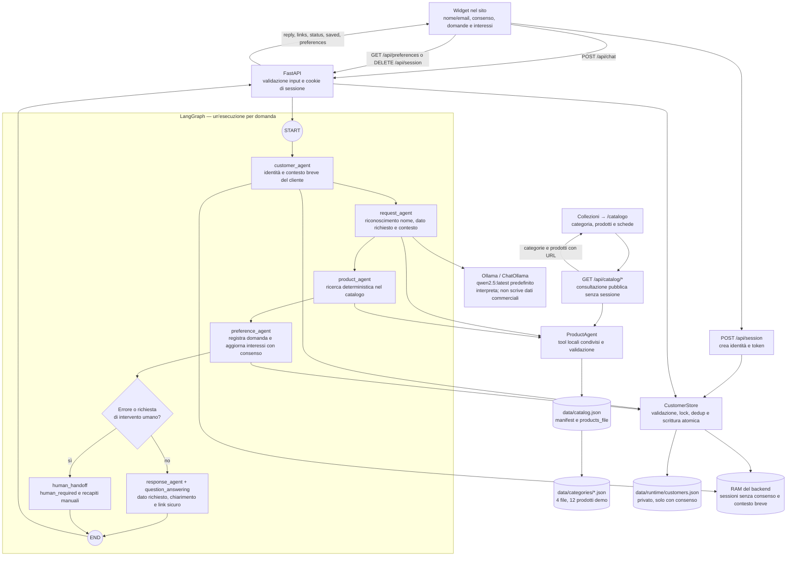

# Architettura del chatbot — gruppo 4

Il widget del sito invia le domande al backend FastAPI, che esegue un grafo
LangGraph reale. Ollama interpreta la richiesta; i nodi Python verificano
catalogo, identità della sessione e autorizzazione al salvataggio. La risposta
commerciale viene composta dal codice usando soltanto i campi richiesti e
i risultati effettivi dei tool. Il catalogo pubblico usa gli stessi dati e
si può consultare senza una sessione chat.

Le tre responsabilità richieste sono distinte: cercare informazioni sui
prodotti, associare il visitatore a nome/email, conservare domande e interessi.
Gli agenti sono nodi specializzati dello stesso processo Python, non server
autonomi o istanze di LLM separate.

## Diagramma del sistema implementato



Il routing dopo `preference_agent` è un ramo condizionale di LangGraph.
Ogni domanda termina con una risposta o con lo stato `human_required`.
Una richiesta di chiarimento si gestisce con un nuovo messaggio del cliente:
**non sono implementati `interrupt()`, checkpointer o ripresa di un grafo
sospeso**. Le ultime categorie, i prodotti e i campi richiesti restano in
RAM per cliente e possono dare contesto al turno successivo. Per esempio,
dopo il prezzo di Aurora, `E in quali colori?` riguarda ancora Aurora.

## Nodi e decisioni

| Nodo | Operazione |
| --- | --- |
| `customer_agent` | Risolve il token attraverso lo store; recupera nome/email autodichiarati e il contesto breve dell'ID cliente. Una sessione non valida richiede di reinserire i dati. |
| `request_agent` | Legge le categorie, riconosce nomi/ID e campi richiesti con regole Python; Ollama propone intento, categoria, riferimento al prodotto e campi con citazioni verificabili nella domanda. I nomi sono risolti sul catalogo e gli ID prodotto devono essere espliciti. Una parola come `pigiama` può produrre più candidati: il cliente sceglie il nome. |
| `product_agent` | Invoca `get_product()` o `list_products()`. Per una domanda sul profilo o una richiesta umana non consulta prodotti. |
| `preference_agent` | Salva la domanda solo con consenso. Conta categorie osservate e prodotti realmente trovati; esclude dai conteggi positivi negazioni, richieste umane, consultazione delle preferenze ed errori. |
| `response_agent` | Usa `backend/question_answering.py` per rispondere al dato chiesto, collegare la scheda pertinente, segnalare dati mancanti o chiedere quale nome si intende. Per una consultazione esplicita del catalogo elenca i nomi trovati con link. Gestisce anche il riepilogo degli interessi. |
| `human_handoff` | Restituisce `human_required`, il motivo e l'indicazione di usare i contatti del negozio. |

Ollama riceve la domanda e l'elenco di ID/nomi delle categorie. I campi
nome/email del profilo e il JSON completo dei clienti non sono inclusi nel
prompt. L'interpretazione restituita dal modello non può autorizzare una
scrittura, selezionare un altro cliente o rendere esistente un prodotto.
Le proposte `product_query`, `requested_fields` e `field_evidence` vengono
confrontate con il testo della domanda; non sono una risposta libera da
mostrare al cliente. Il codice conserva la responsabilità dei fatti.

Le regole non ambigue sono nel codice: tipi e limiti degli input, categorie
valide, presenza degli ID nel testo, esistenza delle schede, opt-in, conteggi,
deduplicazione, routing degli errori e composizione dei dati commerciali.

### Risposte e collegamenti alle schede

`question_answering.py` riconosce prezzo, taglie, colori, materiali,
disponibilità, marca e descrizione. A `Quanto costa il Reggiseno Aurora?`
risponde `Reggiseno Aurora costa 24,90 €.` con avviso demo e un link;
non riversa nella chat tutti i campi della scheda o i prodotti di Intimo.
Una domanda generica sul prodotto riceve una breve descrizione e il prezzo
se indicato. `Quanto costa il pigiama?` richiede di scegliere fra i nomi
trovati. Una richiesta esplicita di catalogo può invece elencare più nomi.

L'output aggiunge `links`, una lista di oggetti `{label, url}`. Gli URL
vengono costruiti in Python dagli ID del catalogo, mai accettati dall'LLM:

```json
{
  "label": "Vedi Reggiseno Aurora",
  "url": "/catalogo?categoria=1&prodotto=1001"
}
```

Gli ID sono riferimenti interni dei dati e degli URL: per conversare il
cliente può usare soltanto il nome. Il contesto breve permette domande
successive sullo stesso articolo; un nuovo nome esplicito seleziona invece
il prodotto citato. Taglie e colori indicati nella scheda non dimostrano
la disponibilità della loro combinazione, che deve essere verificata.

## Contratto del catalogo

`data/catalog.json` usa `schema_version: 1`, `categories` e `products`.
È un manifest: ogni categoria dichiara un percorso relativo `products_file`
come `categories/intimo.json`; l'array `products` del manifest resta vuoto.
Le schede sono nei quattro file sotto `data/categories/`, con struttura:

```json
{
  "schema_version": 1,
  "category_id": 1,
  "products": []
}
```

Ogni scheda inserita in quel file deve avere `category_id: 1`. I relativi
campi e il modello minimo per i futuri dati reali sono nella
[guida ai JSON di categoria](../data/categories/README.md).
La modalità `demo_mode: true` e le schede con `is_demo: true` identificano
12 articoli fittizi, tre per categoria. Anche prezzi, taglie, colori,
materiali e disponibilità servono esclusivamente alla simulazione.
La risposta commerciale contiene un avviso demo composto dal codice;
il widget lo segnala anche nell'accoglienza e nel footer.

| ID categoria | Nome | Intervallo ID |
| --- | --- | --- |
| 1 | Intimo | 1001–1999 |
| 2 | Pigiameria | 2001–2999 |
| 3 | Biancheria | 3001–3999 |
| 4 | Bambino | 4001–4999 |

Il `ProductAgent` rilegge manifest e sorgenti dichiarate a ogni consultazione. Verifica ID
positivi e univoci, categorie esistenti, intervalli non sovrapposti e tipi
dei campi. `1001` è ora la scheda demo Reggiseno Aurora; un ID senza record
rimane inesistente. Il sistema non deduce nome, marca, prezzo o
disponibilità dal numero né dal testo prodotto dall'LLM.

Rimane supportato il formato precedente con prodotti inline nel manifest,
quando nessuna categoria dichiara `products_file`. Un manifest con file
di categoria non può contenere anche prodotti inline. Si leggono soltanto
i percorsi configurati, senza scansionare indiscriminatamente la cartella.
Percorsi assoluti, attraversamenti `..` e collegamenti che risolvono fuori
dalla cartella del manifest vengono rifiutati. File assenti, JSON corrotti,
versioni errate, categoria incoerente o ID duplicati rendono non valido
l'intero catalogo: nessun risultato commerciale parziale viene restituito.
`list_categories()` espone solo ID, nome e intervallo, senza `products_file`.

| Metodo | Risultato |
| --- | --- |
| `list_categories()` | Categorie e intervalli oppure `tool_error`. |
| `get_product(product_id)` | Scheda del catalogo e campi mancanti, `not_found`, `invalid_input` o `tool_error`. |
| `list_products(category_id)` | Schede della categoria, `empty`, `not_found`, `invalid_input` o `tool_error`. |
| `search_products(query)` | Cerca i nomi presenti nel catalogo; i risultati servono a scegliere una scheda o chiedere chiarimento. |

Tutti i risultati hanno `status`, `data`, `message`, `missing_fields`.
Una categoria valida senza prodotti è `empty`: non è un guasto del tool e
non richiede automaticamente l'intervento umano. I campi non conosciuti
restano assenti o `null`, senza valori sostitutivi. La scheda demo `3003`
ha `materials: null` per simulare proprio questo caso; `2003` simula
un articolo non disponibile. L'elenco e le domande da provare sono nella
[guida alla simulazione](prova_chatbot.md).

Gli articoli demo sono conteggiabili nelle preferenze per rendere provabile
l'intero percorso. Prima di usare il catalogo per informazioni reali,
sostituire queste schede con dati confermati dal negozio e aggiornare gli
avvisi della demo.

## Identità, domande e preferenze

Nome ed email sono informazioni dichiarate dal visitatore; non sono
credenziali di autenticazione. Ogni nuova sessione ottiene un ID cliente UUID
e un token casuale. Inserire la medesima email non unisce i profili e non
recupera conversazioni precedenti.

Il cookie `patrizia_session` è `HttpOnly`, `SameSite=Strict` e, con consenso,
ha durata browser di 30 giorni. Nel JSON si conserva solo il suo hash SHA256.
JavaScript usa richieste alla stessa origine; non legge né salva il token in
`localStorage`. `COOKIE_SECURE=false` consente il test HTTP locale; su HTTPS
si configura `COOKIE_SECURE=true`.

La checkbox è inizialmente deselezionata. Senza consenso, la chat usa una
sessione nella RAM del processo e non crea né modifica il file clienti.
Con consenso il JSON contiene questa struttura:

| Percorso nel documento | Contenuto |
| --- | --- |
| `schema_version` | `1`. |
| `customers.<UUID>` | `id`, `name`, `email`, `remember`, `created_at`, `questions`, `preferences`. |
| `customers.<UUID>.questions[]` | Evento con `request_id`, `question`, `timestamp` UTC, `category_ids`, `product_ids`. |
| `customers.<UUID>.preferences.category_counts` | Conteggi delle domande per ID categoria, con chiavi JSON stringa. |
| `customers.<UUID>.preferences.product_counts` | Conteggi delle domande per ID prodotto realmente recuperato. |
| `sessions.<hash SHA256>` | UUID del cliente associato alla sessione. |

Si tratta di interessi osservati, non di preferenze dichiarate o di una
raccomandazione personalizzata. ID ripetuti nello stesso messaggio contano
una volta; domande distinte incrementano i contatori. Una negazione esplicita
blocca gli incrementi per l'intera domanda, scelta conservativa per evitare
di registrare un interesse positivo non voluto. La domanda può comunque
essere conservata se il cliente ha autorizzato il salvataggio.

Il client genera un UUID `request_id` per ogni invio. `Riprova` riusa lo
stesso identificativo. Store e servizio impediscono un doppio salvataggio;
riutilizzare lo stesso ID per un testo diverso produce un errore senza
modificare i dati. La deduplicazione persistente è per ID cliente.

`CustomerStore` usa un `RLock` condiviso per percorso nel processo e salva
con un file temporaneo, `flush`, `fsync` e `os.replace`. Prima delle
operazioni persistenti rilegge e valida il JSON, controllando anche la
coerenza dei conteggi con gli eventi. Errori di lettura, schema o scrittura
sollevano `CustomerStoreError`; un file corrotto non viene sostituito con
un archivio vuoto. Il server lascia disponibile il sito anche quando
l'archivio non è valido all'avvio; le API che devono leggerlo rispondono
con un errore leggibile finché non viene corretto. Il backend va eseguito
con un solo worker.

`Elimina i miei dati` rimuove il cliente, gli eventi, le preferenze, la
sessione persistente e il contesto in RAM, quindi cancella il cookie.
Il file runtime è escluso da Git.

### Che cosa sopravvive a riavvii e ricaricamenti

| Dato | Persistenza |
| --- | --- |
| Domande/interessi con consenso | JSON; recuperati tramite lo stesso cookie anche dopo riavvio del backend. |
| Sessione senza consenso | RAM del backend; persa al riavvio. |
| Ultime categorie/ID per i riferimenti del turno successivo | RAM del backend; persi al riavvio. |
| Messaggi già mostrati nel widget | DOM della pagina; non ricostruiti dal JSON al ricaricamento. |

Il JSON è la memoria delle domande e degli interessi autorizzati, non un
checkpointer LangGraph. Non c'è ancora una dashboard del negoziante.

## API e isolamento dei dati

FastAPI serve sito e API sul medesimo indirizzo. Sono pubblici solo
le pagine del sito e del catalogo, i relativi CSS/JavaScript e la cartella immagini;
non viene montata come statica la radice del progetto. Percorsi come
`/data/runtime/customers.json`, il catalogo JSON e i sorgenti backend non
sono download pubblici. Le API dei clienti accedono soltanto alla sessione
identificata dal cookie e usano `Cache-Control: no-store`.

La pagina `/catalogo` usa `categoria` e `prodotto` come parametri dell'URL.
`/catalogo?categoria=1` seleziona Intimo;
`/catalogo?categoria=1&prodotto=1001` seleziona anche Aurora. I collegamenti
in Collezioni e quelli della chat puntano alla stessa pagina.

| Metodo e percorso | Operazione |
| --- | --- |
| `GET /api/catalog/categories` | Categorie con URL e numero di prodotti; accesso pubblico. |
| `GET /api/catalog/products` | Tutte le schede pubbliche; `?category_id=1` filtra la categoria. |
| `GET /api/catalog/products/{product_id}` | Una scheda pubblica con nome categoria e `product_url`. |
| `GET /api/session` | Cliente della sessione o `customer: null`. |
| `POST /api/session` | Valida nome/email/consenso, crea la sessione e imposta il cookie. |
| `DELETE /api/session` | Elimina dati associati, contesto e cookie. |
| `GET /api/preferences` | Restituisce conteggi e categorie per il riepilogo del widget. |
| `POST /api/chat` | Riceve `message` e `request_id`; restituisce risposta, `links`, stato e interessi. |

Le tre API del catalogo non richiedono cookie o identità; proiettano soltanto
i campi commerciali ammessi, senza percorsi dei sorgenti o dati personali.
Riferimenti inesistenti restituiscono 404, input non validi 422, errori del
catalogo 503. Una categoria esistente e vuota restituisce `products: []`.

Una sessione è richiesta per chat e preferenze. I messaggi HTTP sono limitati
a 2000 caratteri; `request_id` deve essere un UUID. Il backend rifiuta campi
JSON aggiuntivi e richieste di modifica con un header `Origin` appartenente
a un altro indirizzo. Il browser usa `textContent` per mostrare i messaggi.

## Informazioni mancanti, errori e intervento umano

| Caso | Comportamento visibile |
| --- | --- |
| Categoria vuota o ID senza scheda | Messaggio esplicito; nessuna scheda sostitutiva inventata. |
| Campo del catalogo mancante | Il dato viene segnalato come non disponibile, senza completarlo con l'LLM. |
| Articolo non disponibile | La risposta riporta la disponibilità della scheda; non conferma prenotazioni o ordini. |
| Domanda senza oggetto chiaro o nome ambiguo | `clarification`: richiesta di indicare la categoria o scegliere il nome, con link ai candidati quando disponibili. L'ID non è obbligatorio. Il messaggio seguente avvia un nuovo turno. |
| Ollama assente, timeout o JSON non valido | Fallback deterministico, `llm_available: false` e stato `degraded`; il widget segnala il limite. |
| Manifest/file di categoria non valido o errore nel recupero prodotti | In chat `human_required` con richiesta di controllo del negozio; nelle API pubbliche HTTP 503 e messaggio leggibile. Nessun catalogo parziale. |
| Scrittura dell'archivio fallita durante il grafo | `saved: false`, `human_required`, messaggio di errore; nessuna conferma falsa di salvataggio. Il riepilogo precedente viene mantenuto quando è leggibile. |
| Archivio non disponibile nell'API | Errore HTTP 503 con messaggio leggibile, senza esporre il percorso locale. Il sito resta raggiungibile anche con un archivio corrotto all'avvio, senza sostituirlo con un JSON vuoto. |
| Sessione non valida | HTTP 401 sulle operazioni protette; il widget chiede nuovamente nome/email. |
| JSON o campi della richiesta non validi | HTTP 422 con un messaggio leggibile; la richiesta non viene usata per modificare il profilo. |
| Eccezione inattesa nel tool o nel backend | Il tool conduce a `human_required`; l'API restituisce un messaggio JSON generico in caso di errore interno, senza tracce o percorsi locali. |
| Cliente chiede un operatore | `human_required` e indicazione di usare i recapiti del sito. |
| Connessione browser/server interrotta | Pulsante di retry con lo stesso ID domanda, per evitare doppi salvataggi. |

Un salvataggio fallito non viene fissato come risposta definitiva nella cache:
la stessa richiesta può essere riprovata dopo la correzione. Se il salvataggio
era già riuscito, la deduplicazione impedisce un secondo evento. Quando non
è possibile recuperare le preferenze, `preferences_available: false` evita
che il widget sostituisca il riepilogo già visibile con conteggi vuoti.
Le schede demo espongono `demo_notice` oltre all'avviso nella risposta.

`human_handoff` non apre ticket, non invia messaggi e non attende una risposta
del personale. Non sono presenti dashboard, approvazione del gestore o
riavvio del flusso tramite `Command(resume=...)`. È un passaggio manuale
esplicito, rappresentato nello stato e nel testo mostrato al cliente.

## Collegamenti con i materiali di classe

| Materiale nel workspace | Elemento ripreso |
| --- | --- |
| `Giorno 1/Lab/Project_Canvas.docx` | Fonti dei dati, autonomia consentita, separazione fra regole e giudizio del modello. |
| `Giorno 2/Lab/01_MCP/simple_mcp_server.py` | Tool con input e risultati strutturati. In questo progetto sono funzioni Python locali; MCP non è necessario. |
| `Giorno 2/Lab/02_A2A/a2a_simulation.py` | Responsabilità separate e stati espliciti; gli agenti qui condividono un solo processo. |
| `Giorno 3/Lab/02_Agente_con_Tools_Ollama.ipynb` e `04_Agente_as_Tool.ipynb` | Ollama locale, strumenti di dominio e componenti specializzati. |
| `Giorno 4/Lab/02_LangGraph_MVP.ipynb` e `04_Esercitazione_Orchestrator.ipynb` | `TypedDict`, `StateGraph`, nodi, routing condizionale e verifiche dei percorsi. |
| `Giorno 4/Lab/03_LangGraph_HumanInLoop.ipynb` | Riferimento didattico per gli stati che richiedono una persona; il meccanismo interrupt/checkpoint del notebook non è implementato in questo MVP. |
| `esame2/Gruppo 4/deliverables/Esame.ipynb` | Interpretazione strutturata con Ollama, tool specializzati, dati mancanti espliciti e regole deterministiche. I dataset dell'esame non diventano prodotti del negozio. |

Riferimenti ufficiali consultati: [Graph API di LangGraph](https://docs.langchain.com/oss/python/langgraph/graph-api),
[integrazione ChatOllama](https://docs.langchain.com/oss/python/integrations/chat/ollama)
e [cookie nelle risposte FastAPI](https://fastapi.tiangolo.com/advanced/response-cookies/).

L'interpretazione Ollama usa ora un JSON Schema in `format`, oltre alla
validazione Python: un nome come `Reggiseno Aurora` non deve finire nella lista
degli ID numerici. Riferimento: [Structured Outputs di Ollama](https://docs.ollama.com/capabilities/structured-outputs).
Gli handler HTTP seguono la [gestione degli errori di FastAPI](https://fastapi.tiangolo.com/tutorial/handling-errors/).

## Verifiche

Dalla cartella `SITO NEGOZIO`:

```powershell
python -m unittest discover -s tests -v
```

I test coprono catalogo per categoria e formato precedente, percorsi delle
sorgenti, nomi nella domanda, risposte mirate e link, chiarimenti, contesto,
API pubbliche, informazioni mancanti, errori dei file, consenso,
isolamento tra clienti, persistenza dopo riavvio, token non
in chiaro, deduplicazione, conteggi, cancellazione e percorsi del grafo/API.
Le fixture usano directory temporanee e un interprete controllato; non
richiedono Ollama e non creano schede nel catalogo reale.

La [guida alla prova](prova_chatbot.md) descrive il percorso browser per
verificare i 12 prodotti demo, il salvataggio con e senza consenso,
le informazioni mancanti, gli ID inesistenti e l'intervento umano.
I test automatici devono restare indipendenti da Ollama e usare file
temporanei per i dati personali. Comandi e configurazione sono riportati
nel [README](../README.md).
